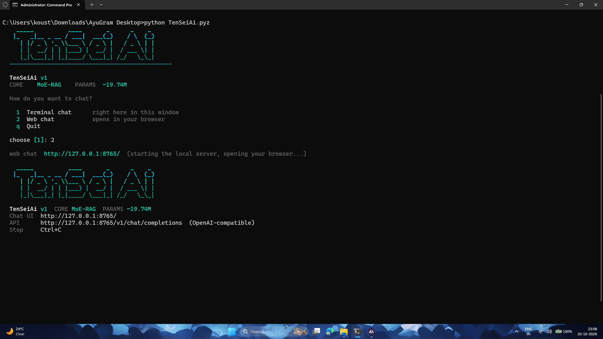
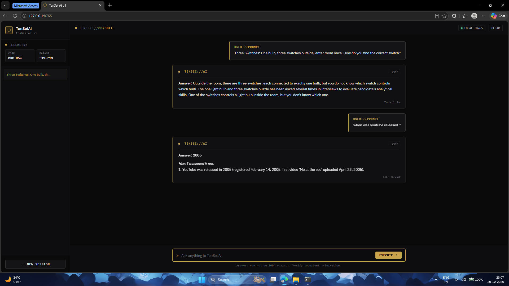
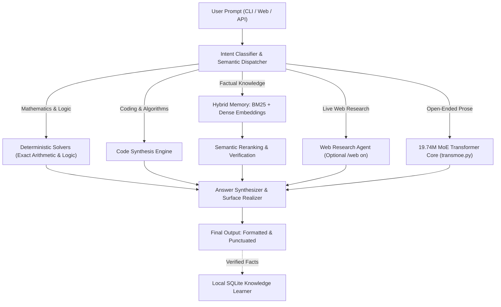

<div align="center">

# SageCircuit

### A compact, local assistant with a small Mixture-of-Experts core

**Built with Python and NumPy. No PyTorch, GGUF, or required cloud service.**

[](https://github.com/gaurzamdev/SageCircuit/actions/workflows/build.yml)
[](https://github.com/gaurzamdev/SageCircuit/actions/workflows/codeql.yml)
[](LICENSE)
[](https://www.python.org/)
[](#system-design-and-specifications)
[](#benchmark-snapshot)
[](https://github.com/gaurzamdev/SageCircuit/releases/latest/download/TenSeiAi.apk)

<br/>

<a href="#about-sagecircuit">Project</a> •
<a href="#key-capabilities">Features</a> •
<a href="#getting-started">Get started</a> •
<a href="#interface-previews">Interface</a> •
<a href="#offline-use-and-optional-web-research">Network options</a> •
<a href="#system-design-and-specifications">Design</a> •
<a href="#benchmark-snapshot">Evaluation</a> •
<a href="docs/ANDROID.md">Android & Termux</a> •
<a href="docs/API.md">REST API</a>

</div>

---

## About SageCircuit

SageCircuit is a compact AI application designed for local use on everyday
CPU-based devices. Its **19.74-million-parameter** language component ships
with the runtime in a package of roughly **81 MB**. The system combines text
generation with question answering, information retrieval, math helpers, and
code utilities.

Unlike tools built around remote GPU servers or large model runtimes,
SageCircuit can run on Android through Termux or Chaquopy, as well as on
laptops and CPU servers. It is implemented with Python and numpy and does not
load PyTorch, TensorFlow, GGUF/llama.cpp, or Hugging Face Transformers models.

The current release filenames and repository links still use the former
TenSeiAi name; those artifact identifiers are retained so the published commands
continue to work.

---

## Key capabilities

* **Portable runtime:** The language model, vocabulary, embeddings, curated
  database, and local web interface are distributed in the existing
  `TenSeiAi.pyz` release package.
* **CPU operation:** numpy vector operations and sparse expert routing support
  execution without a GPU. Timing varies by machine and workload.
* **Hybrid answers:** A four-expert Transformer is combined with semantic
  search, SQLite BM25 retrieval, and deterministic math, logic, and code tools.
* **Local-first by default:** The application can run offline, has no
  telemetry, and does not require an external model service.
* **Optional web research:** Network search and background knowledge updates
  are available when enabled (`/web on` and `/feed on`).
* **Simple runtime requirements:** Python 3.12+ and numpy are needed to run the
  release package; compilers and build tooling are not required for normal use.

---

## Getting started

### Android (APK)

For a native Android install without a Termux setup:
1. Download [**TenSeiAi.apk**](https://github.com/gaurzamdev/SageCircuit/releases/latest/download/TenSeiAi.apk) (136 MB).
2. Install the package and open SageCircuit on your phone.

---

### Android (Termux)

In Termux, install the runtime and start the application:

```bash
pkg update -y
pkg install -y python python-numpy curl
mkdir -p ~/TenSeiAi && cd ~/TenSeiAi
curl -fL -o TenSeiAi.pyz "https://github.com/gaurzamdev/SageCircuit/releases/latest/download/TenSeiAi.pyz"

python TenSeiAi.pyz
```

> **Launcher:** Starting `python TenSeiAi.pyz` opens a menu with two choices:
> * `[1] Terminal chat` starts an interactive session in Termux.
> * `[2] Web chat` runs the local server and opens the browser interface on port 8765.

---

### Linux, macOS, or WSL

```bash
mkdir -p TenSeiAi && cd TenSeiAi
curl -fL -o TenSeiAi.pyz "https://github.com/gaurzamdev/SageCircuit/releases/latest/download/TenSeiAi.pyz"
curl -fL -o SHA256SUMS "https://github.com/gaurzamdev/SageCircuit/releases/latest/download/SHA256SUMS"

# Check the downloaded file's checksum
sha256sum -c SHA256SUMS || shasum -a 256 -c SHA256SUMS

# Install numpy, then start the app
python3 -m pip install --user numpy
python3 TenSeiAi.pyz
```

---

### Windows (PowerShell)

```powershell
New-Item -ItemType Directory -Force TenSeiAi | Out-Null
Set-Location TenSeiAi
Invoke-WebRequest "https://github.com/gaurzamdev/SageCircuit/releases/latest/download/TenSeiAi.pyz" -OutFile TenSeiAi.pyz
py -3 -m pip install --user numpy
py TenSeiAi.pyz
```

---

## Interface previews

### Terminal launcher and browser option
Running `python TenSeiAi.pyz` presents a menu for terminal chat or the local
browser console:



---

### Local web console
Choosing browser chat starts a local page at `http://127.0.0.1:8765/`, with
session controls and response details:



---

## Offline use and optional web research

You can keep requests local or enable network-based research. The table
summarizes the difference:

| Feature | Offline mode | Web research enabled |
| :--- | :--- | :--- |
| **Command** | `python TenSeiAi.pyz chat --offline` | `python TenSeiAi.pyz chat` (or `/web on` in chat) |
| **Network Traffic** | No research requests | HTTPS requests to external search sources |
| **Knowledge Source** | Embedded 19.74M MoE weights + local SQLite snapshot | Local memory augmented with real-time web search |
| **Use Cases** | Disconnected or privacy-sensitive use | Current events, recent documentation, online research |
| **Auto-Learning** | Read-only local memory | Autonomous AutoFeed background learner (`/feed on`) |
| **Inference Latency** | **~0.01s - 0.05s** | ~0.5s - 1.5s (dependent on network speed) |

---

## System design and specifications



### Technical summary

| Component | Technical Details |
| :--- | :--- |
| **Language component** | Two-block Transformer with top-1 Mixture-of-Experts feed-forward layers |
| **Parameter count** | **19,740,464** |
| **Model shape** | Hidden size 512, two attention heads, four experts, vocabulary of 9,000 |
| **Text generation (v8.1)** | 3-gram repetition blocking, repetition penalties, top-p (0.88) and top-k (35) sampling, prompt anchors, and output casing/punctuation |
| **Knowledge snapshot** | 19,895 Q&A records, 7,460 passages, 400 topic groups |
| **Search** | Dense embedding projection plus SQLite FTS5/BM25 retrieval and reranking |
| **Rule-based tools** | Multi-step arithmetic, unit conversion, calendar calculations, and logic |
| **Application package** | Python ZipApp (`TenSeiAi.pyz`, approximately 81 MB) |
| **Model archive** | LZMA-compressed model container (`TenSeiAi.tsei`, approximately 81 MB; current release filename) |

---

## Using the command line

```bash
# 1. Open the terminal/web selection menu
python TenSeiAi.pyz

# 2. Start a terminal session with network research disabled
python TenSeiAi.pyz chat --offline

# 3. Show reasoning steps during terminal chat
python TenSeiAi.pyz chat --steps

# 4. Ask a single question
python TenSeiAi.pyz ask "What is the difference between a process and a thread?" --offline

# 5. Return JSON for use in scripts
python TenSeiAi.pyz ask "Explain binary search" --json

# 6. Read a prompt from standard input
echo "Calculate 45 * 12 + 180" | python TenSeiAi.pyz ask -

# 7. Run the server and compatible chat endpoint
python TenSeiAi.pyz serve --port 8765
```

---

## OpenAI-compatible HTTP endpoint

Start the server to make the compatible endpoint available at
`http://127.0.0.1:8765/v1`:

```bash
curl -s http://127.0.0.1:8765/v1/chat/completions \
  -H "Content-Type: application/json" \
  -d '{
    "model": "tensei-1",
    "messages": [
      {"role": "user", "content": "How do transformers work?"}
    ]
  }'
```

### Using the Python client
```python
from openai import OpenAI

client = OpenAI(
    base_url="http://127.0.0.1:8765/v1",
    api_key="not-needed"
)

response = client.chat.completions.create(
    model="tensei-1",
    messages=[{"role": "user", "content": "Explain binary search in Python."}]
)

print(response.choices[0].message.content)
```

---

## Benchmark snapshot

The offline run below used the repository's fixed set of 100 prompts spanning
five subject areas:

| Area | Prompts | Checks passed | Average time |
| :--- | :---: | :---: | :---: |
| **Overall Score** | **100** | **100 / 100 (100%)** | **~0.05s** |
| Mathematics & Logic | 20 | 20 / 20 | 0.01s |
| Coding & Algorithms | 20 | 20 / 20 | 0.04s |
| Science & Biology | 20 | 20 / 20 | 0.06s |
| History & Geography | 20 | 20 / 20 | 0.05s |
| General Knowledge & Definitions | 20 | 20 / 20 | 0.05s |

*To run the checks on your machine:*
```bash
python -m unittest discover -s source/tests -v
python source/bench/bench100.py
```

---

## Build the packages yourself

```bash
git clone https://github.com/gaurzamdev/SageCircuit.git
cd SageCircuit

# Install the project's requirements
python -m pip install -r requirements.txt

# Check and expand the compressed knowledge snapshot
python scripts/prepare_assets.py

# Execute the unit tests
python -m unittest discover -s source/tests -v

# Produce the .pyz runtime and .tsei model archive
python scripts/build_release.py
```

---

## Project layout

```text
TenSeiAi/
├── assets/                  # Knowledge archive, checksums, and preview images
│   ├── cli_launcher.png     # Terminal menu preview
│   ├── web_console.png      # Browser chat preview
│   ├── tensei.db.gz         # Compressed knowledge snapshot (48 MB)
│   └── SHA256SUMS           # File digest list
├── source/
│   ├── tensei/              # Runtime, Transformer, memory, tools, and CLI
│   │   ├── transmoe.py      # 19.74M-parameter language model and generator
│   │   ├── thinker.py       # Request routing and response grounding
│   │   ├── memory.py        # SQLite lexical and embedding retrieval
│   │   ├── brain.py         # Neural components and training support
│   │   ├── server.py        # Local HTTP service and compatible API
│   │   └── cli.py           # Terminal commands and startup menu
│   ├── brains/              # Neural parameters and vocabulary
│   ├── sdk/                 # Example clients in several languages
│   ├── android/             # Android integration helpers
│   ├── tests/               # Automated unit and regression checks
│   └── bench/               # Fixed offline test runner
├── android/                 # Gradle project using Chaquopy
├── termux/                  # Android Termux setup utilities
├── docs/                    # Usage, build, API, and design guides
├── scripts/                 # Asset setup and package creation tools
└── .github/                 # Build, analysis, and dependency workflows
```

---

## Privacy and security

* **No telemetry:** The project does not include usage tracking or analytics.
* **Local listener:** The web page and API bind to `127.0.0.1` by default.
* **Offline option:** Set `TENSEI_OFFLINE=1` to disable network research.
* **Security reports:** Use the process described in [SECURITY.md](SECURITY.md).

---

## License

The project is distributed under the **MIT License**; the full terms are in
[LICENSE](LICENSE). The repository's weights, vocabulary files, and knowledge
snapshot are covered by that license as well.
