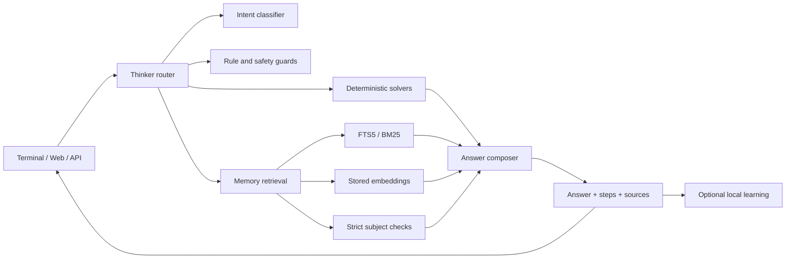

# How the system is arranged

SageCircuit is a compact, self-contained AI application designed to run locally.
Rather than reproduce the scale of a large language model, it combines
inspectable components into a CPU-friendly assistant that can be distributed
as a file.

## From prompt to response



`source/tensei/thinker.py` contains the `Thinker`, which coordinates the
request path. It categorizes prompts, handles local date/time and identity
queries, selects code or math helpers when suitable, searches local memory,
and assembles the response. If local results are insufficient, it can also
use optional web research when network access has not been disabled.

## Core components

| Module | Responsibility |
|---|---|
| `tensei/thinker.py` | Coordinates request routing, retrieval, grounding, and response assembly |
| `tensei/brain.py` | Manages neural modules, training, and model metadata |
| `tensei/memory.py` | Stores knowledge and handles SQLite search, embeddings, topics, and learning |
| `tensei/embed.py` | Creates hashed and learned vector representations |
| `tensei/nn.py` | Provides numpy-based MLPs and related training routines |
| `tensei/lm.py` / `tensei/transmoe.py` | Implements the Transformer/MoE text model |
| `tensei/codecore.py` / `tensei/codesmith.py` | Produces code through deterministic helpers |
| `tensei/mathcore.py` / `tensei/reasoncore.py` | Supplies arithmetic, conversion, logic, and reasoning functions |
| `tensei/model_file.py` | Reads and writes the TSM1/TSMC model format |
| `tensei/build.py` | Packages the app as a portable `.pyz` file |
| `tensei/server.py` | Hosts the local web page and HTTP routes |
| `tensei/cli.py` | Handles terminal chat, single prompts, and build/export actions |
| `tensei/android.py` | Connects the engine to Chaquopy |
| `web/index.html` | Provides the standalone local chat page |

## Knowledge and runtime storage

SQLite holds the project's knowledge and runtime records. Its principal
tables and search data include:

- `qa` stores questions and answers with their category, source, confidence,
  and feedback.
- `docs` holds passages alongside page names, URLs, topics, and timestamps.
- `topics` tracks items for research and learning.
- Full-text indices support keyword-oriented search.
- Embedding data supports vector-based retrieval.

The database shipped with the project is an initial snapshot. New runtime
learning goes to the active `TENSEI_HOME`, usually `~/.tensei_ai`. Source
builds read `source/data/tensei.db`, which can be reconstructed from the
compressed archive with `scripts/prepare_assets.py`.

## Model packaging

SageCircuit stores model data in a project-specific format rather than GGUF. Its
reader and writer are implemented in `source/tensei/model_file.py`.

```text
TSM1 or TSMC
uint32 meta_length
JSON metadata
uint32 blob_count
for each blob:
  uint16 name_length
  name
  uint64 payload_length
  payload
```

Depending on the payload, `TSMC` entries use LZMA or zlib compression. The
container includes trained files under `brains/`, the SQLite database, and
the browser interface. Its arrays and database are platform-independent, so a
`.tsei` file can be used across operating systems. Native acceleration is
optional.

The release `.pyz` is a Python zipapp with a shell bootstrap. It contains a
TSM1 model and packaged engine modules, but relies on the host's Python 3
interpreter and does not include CPython or numpy.

## Release build sequence

```text
assets/tensei.db.gz
        │
        ▼
scripts/prepare_assets.py  ──►  source/data/tensei.db
        │
        ▼
source/tensei/model_file.py
        │
        ├──► dist/TenSeiAi.tsei
        │
        └──► source/tensei/build.py ──► dist/TenSeiAi.pyz
```

Release creation sets `TENSEI_HOME=source`, `TENSEI_OFFLINE=1`, and
`TENSEI_NO_LEARN=1`. It neither downloads a model nor contacts a hosted
service.

## Operational security limits

- The HTTP process is intended for local chat, not as a hardened shared
  service; it lacks authentication and allows permissive CORS.
- It listens on `127.0.0.1` by default. Before remote use, put it behind a
  reverse proxy with authentication and request limits.
- Parsing a model file does not run inside a sandbox. Review the parser and
  test untrusted containers in isolation.
- Enabling web research sends search requests to external providers.
- Android signing credentials are not supplied; use a key that you control.

For details, consult [SECURITY.md](../SECURITY.md) and [BUILD.md](BUILD.md).
